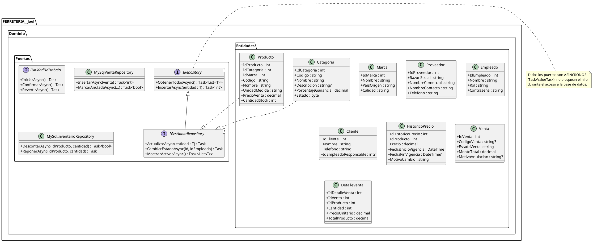
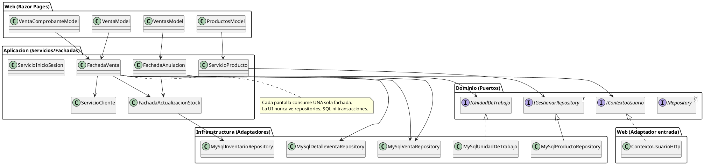
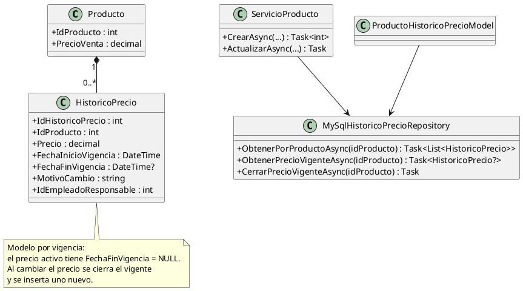

# Aplicación de Clean Code y Principios SOLID en un Proyecto de Software

**Sistema de Gestión Comercial — Ferretería Joel**

---

## Carátula

| Campo | Dato |
|-------|------|
| **Universidad** | [UNIVERSIDAD CATÓLICA BOLIVIANA — UCB] |
| **Materia** | [Materia, Sigla y sección] |
| **Docente** | [Nombre del docente] |
| **Semestre / Gestión** | [Semestre] — 2026 |
| **Integrantes** | [Nombre 1], [Nombre 2], [Nombre 3] |
| **Fecha de entrega** | 01/09/2026 |
| **Repositorio** | https://github.com/Macacofig/FERRETERIA-Joel |

---

# 1. Introducción

## 1.1 Breve explicación de los principios SOLID

SOLID es un acrónimo que reúne cinco principios de diseño orientado a objetos
propuestos por Robert C. Martin (Uncle Bob). Su objetivo es producir software
que sea fácil de **mantener**, **extender** y **probar**, reduciendo el acoplamiento
y la duplicación de código.

| Principio | Nombre | Idea central |
|-----------|--------|--------------|
| **S** | Single Responsibility Principle (Principio de Responsabilidad Única) | Una clase o método debe tener una sola razón para cambiar. |
| **O** | Open/Closed Principle (Principio Abierto/Cerrado) | Las entidades deben estar abiertas a la extensión pero cerradas a la modificación. |
| **L** | Liskov Substitution Principle (Principio de Sustitución de Liskov) | Una clase derivada debe poder sustituir a su clase base sin alterar el comportamiento esperado. |
| **I** | Interface Segregation Principle (Principio de Segregación de Interfaces) | Los clientes no deben verse obligados a depender de interfaces que no utilizan. |
| **D** | Dependency Inversion Principle (Principio de Inversión de Dependencias) | Depender de abstracciones, no de clases concretas. |

Además, el **Clean Code** (también popularizado por Robert C. Martin) aporta un
conjunto de buenas prácticas de estilo: nombres significativos, métodos pequeños,
código con intención clara, eliminación de código duplicado o muerto, y manejo
correcto de errores con mensajes legibles para el usuario final.

## 1.2 Objetivo del trabajo práctico

- Investigar y comprender los principios SOLID y las buenas prácticas de
  Clean Code.
- Aplicarlos de forma real en un sistema web con **ASP.NET Core Razor Pages + C#
  + ADO .NET sobre MySQL**.
- Organizar el sistema con una **arquitectura hexagonal (puertos y adaptadores)**
  materializada en **proyectos `.csproj` por capa** dentro de una misma solución.
- Construir **CRUD completos** sobre las tablas del catálogo (Productos,
  Categorías, Marcas y Proveedores), cada una con al menos 4 atributos
  independientes.
- Validar la **entrada de datos** con base en la **lógica de negocio** y con
  mensajes claros para el usuario.
- **Incorporar el control de datos históricos** en una de las tablas (histórico
  de precios de productos) con un modelo escalable y una **vista que muestre el
  histórico de cambios**.
- Desarrollar la **ventana Home** con menú de opciones, logo y línea gráfica
  propia del negocio.
- Incorporar **autenticación por cookie y al menos dos roles diferenciados**.
- Implementar el **proceso principal de ventas** (registro, historial,
  comprobante y **anulación lógica**) con **transacciones** y **asincronía**.
- Ordenar el trabajo en un **repositorio Git** (GitHub) con ramas temáticas y
  commits descriptivos.

---

# 2. Descripción del proyecto

## 2.1 Contexto y problemática a resolver

**Ferretería Joel** es un comercio dedicado a la venta de herramientas y
materiales de construcción. Su operación actual tiene las siguientes
características:

- **Venta por unidades y por fracción**: el cliente puede comprar productos al
  por mayor (una bolsa) o fraccionados (por ejemplo, *un montoncito de clavos*),
  lo que obliga al sistema a trabajar con unidades de medida y stock real.
- **Roles de empleados**:
  - Responsable de **caja**, que cobra las ventas.
  - Responsable de **almacén**, que revisa existencias, repone stock y se
    comunica con los proveedores de confianza.
  - Responsable de **atención al cliente**.
- **Flujo de compra actual (manual)**:
  1. El cliente consulta si el producto existe.
  2. El responsable de atención anota lo pedido en una **boleta**.
  3. El cliente paga en caja.
  4. Se le entrega la mercancía.

**Problemática identificada:**

- El control de inventario se hace **"a ojo"**; el responsable de almacén repone
  cuando percibe faltantes, sin datos confiables.
- La caja usa **talonario de ventas con copias**, sin facturación ni registros
  digitales.
- No existe un catálogo digital único de productos, categorías, marcas ni
  proveedores.
- No hay trazabilidad de los **cambios históricos** (por ejemplo, evolución de
  precios de un producto) ni de las **ventas y sus anulaciones**.

**Solución implementada (alcance actual):** un sistema administrativo web
(**monolito**) con **arquitectura hexagonal** que ya cuenta con:

1. **Ventana Home** (marca, historia y estadísticas), menú de opciones y login.
2. **Catálogos base** —Productos, Categorías, Marcas y Proveedores— con CRUD
   completo, validaciones de negocio y **histórico de precios** del producto.
3. **Seguridad** —inicio/cierre de sesión por cookie **solo para empleados**
   (roles `Administrador` y `EmpleadoVenta`) y bitácora de sesiones.
4. **Módulo de Ventas** —registro de venta con carrito, historial,
   comprobante/recibo y **anulación lógica**— todo sobre
   **transacciones atómicas** y **flujo asíncrono de extremo a extremo**.

## 2.2 Requisitos funcionales y evidencia en el código

| # | Requisito | Tabla / Área | Evidencia en el código |
|---|-----------|--------------|------------------------|
| R1 | Listar registros ordenados | Categorías | `Infraestructura/Repositorios/MySqlCategoriaRepository.cs` (`ORDER BY`) |
| R2 | Listar registros ordenados | Productos | `Infraestructura/Repositorios/MySqlProductoRepository.cs` |
| R3 | Listar registros ordenados | Marcas | `Infraestructura/Repositorios/MySqlMarcaRepository.cs` |
| R4 | Listar registros ordenados | Proveedores | `Infraestructura/Repositorios/MySqlProveedorRepository.cs` |
| R5 | Insertar con validación de negocio | Categorías | `Aplicacion/Servicios/ServicioCategoria.cs` + `Dominio/Validaciones/CategoriaValidaciones.cs` |
| R6 | Insertar con validación de negocio | Productos | `ServicioProducto.cs` + `ProductoValidaciones.cs` |
| R7 | Insertar con validación de negocio | Marcas | `ServicioMarca.cs` + `MarcaValidaciones.cs` |
| R8 | Insertar con validación de negocio | Proveedores | `ServicioProveedor.cs` + `ProveedorValidaciones.cs` |
| R9 | Actualizar | Catálogo | `ServicioProducto/Categoria/Marca/Proveedor.*Async` |
| R10 | Eliminación lógica (soft delete) | Catálogo | `IGestionarRepository<T>.CambiarEstadoAsync(...)` + handlers `OnPostEliminarAsync` |
| R11 | Histórico de cambios con vista | Producto | `ServicioHistoricoPrecio.cs` + `Pages/ProductoHistoricoPrecio.cshtml` |
| R12 | Home + menú con logo | — | `Pages/Index.cshtml` + `Pages/Shared/_Layout.cshtml` |
| R13 | Login + logout | Empleado | `ServicioInicioSesion.cs`, `Pages/Login.cshtml` |
| R14 | ≥2 roles diferenciados | — | `Dominio/Constantes/RolesSistema.cs` (`Administrador`, `EmpleadoVenta`) + convenciones `AuthorizePage` en `Program.cs` |
| R15 | Registro de venta | Venta/DetalleVenta | `Aplicacion/Servicios/FachadaVenta.cs` (`RegistrarVentaAsync`) |
| R16 | Anulación lógica + reposición | Venta | `Aplicacion/Servicios/FachadaAnulacion.cs` (`AnularVentaAsync`) |
| R17 | Comprobante/recibo | Venta | `FachadaVenta.ObtenerComprobanteAsync` + `Dominio/Utilidades/NumeroALetras.cs` |
| R18 | Bitácora de sesiones | Bitácora | `ServicioBitacora.cs` + `MySqlBitacoraRepository.cs` |

Cada tabla implementada cumple con tener al menos **4 atributos independientes**
(sin contar claves ni atributos de auditoría):

| Tabla | Atributos independientes |
|-------|--------------------------|
| **Categoria** | Codigo, Nombre, Descripcion, PorcentajeGanancia (`Dominio/Entidades/Categoria.cs`) |
| **Marca** | Nombre, Descripcion, PaisOrigen, Calidad (`Dominio/Entidades/Marca.cs`) |
| **Producto** | Codigo, Nombre, Descripcion, UnidadMedida, PrecioVenta, IdCategoria, IdMarca (`Dominio/Entidades/Producto.cs`) |
| **Proveedor** | RazonSocial, NombreComercial, NombreContacto, Telefono, CorreoElectronico, Direccion (`Dominio/Entidades/Proveedor.cs`) |

Convención de auditoría común: `Estado`, `FechaRegistro` y `FechaActualizacion`
son tratados como atributos de auditoría (no se cuentan entre los independientes)
y en todos los repositorios los valores de `FechaActualizacion` se asignan con
`NOW()`/`CURRENT_TIMESTAMP` sin intervención de la lógica de la página.

---

# 3. Arquitectura

## 3.1 Monolito con arquitectura hexagonal

El sistema es un **monolito** (un único despliegue: la aplicación web) organizado
internamente como **arquitectura hexagonal (puertos y adaptadores)**, con el
código separado en **proyectos por responsabilidad técnica** dentro de la misma
solución (`.slnx`).

| Proyecto | Responsabilidad | Depende de |
|----------|-----------------|------------|
| `FERRETERIA__Joel.Dominio` | Núcleo: `Entidades/`, `Puertos/`, `Validaciones/`, `ConfiguracionValidacion/`, `Constantes/`, `Utilidades/` | (nada) |
| `FERRETERIA__Joel.Aplicacion` | Casos de uso: `Servicios/` (servicios y **fachadas**) y `Modelos/` (DTOs) | Dominio + Infraestructura |
| `FERRETERIA__Joel.Infraestructura` | Adaptadores de salida: `Repositorios/` (MySQL), `Conexion/`, `Factories/`, `Seguridad/` (Argon2) | Dominio |
| `FERRETERIA  Joel` (Web) | Adaptador de entrada: `Pages/` (Razor Pages), `Servicios/ContextoUsuarioHttp`, `Helpers/`, `Program.cs` | Dominio + Aplicación + Infraestructura |

**Regla de dependencias (regla de dependencia de Clean Architecture):**

```text
Web ─▶ Aplicacion ─▶ Dominio ◀─ Infraestructura
                 └───────────────────────┘
```

Las flechas **apuntan hacia el Dominio**: la Aplicación depende de los **puertos y
entidades** del Dominio y, además, referencia Infraestructura para consumir las
implementaciones concretas de operación especial y las fábricas
(`RepositoryCreator`) que se registran por inyección de dependencias. El Dominio
no conoce ni `MySql.Data` ni ASP.NET Core.

## 3.2 Puertos y adaptadores

**Puertos (contratos en `Dominio/Puertos/`):**

| Puerto | Rol |
|--------|-----|
| `IRepository<T>` | Contrato base: `Task<List<T>> ObtenerTodosAsync()`, `Task<int> InsertarAsync(T)` |
| `IGestionarRepository<T>` | Extiende el base: `ActualizarAsync`, `CambiarEstadoAsync`, `MostrarActivosAsync` |
| `IRepositoryEmpleado` | Extiende `IRepository<Empleado>`: ciclo de vida de la cuenta (baja/reactivación) y proyecciones con y sin credenciales |
| `IUnidadDeTrabajo` | Transacción (`IniciarAsync` / `ConfirmarAsync` / `RevertirAsync`) |
| `IHasheadorContrasena` | Hash y verificación de contraseñas |
| `IContextoUsuario` | Identidad del usuario en sesión (`IdEmpleado`, `NombreCompleto`, `Rol`) |
| `ICacheSeleccion` | Caché distribuida compartida entre réplicas (`ObtenerAsync`, `GuardarAsync`, `InvalidarPorPrefijoAsync`) |
| `IIdentificadorReplica` | Identificador real de la réplica que atiende la petición |

> Ya **no** existen puertos específicos por entidad: los repositorios concretos
> implementan **solo** `IRepository<T>` / `IGestionarRepository<T>`. Las
> operaciones que no encajan en un CRUD (folio de venta, anulación, stock,
> precio vigente, bitácora) se exponen como **métodos concretos** `virtual` y
> se inyectan directamente por DI.

**Adaptadores (Infraestructura y Web):**

- `MySql*Repository` implementan los puertos genéricos (`MySqlProductoRepository`
  implementa `IGestionarRepository<Producto>`, `MySqlEmpleadoRepository`
  implementa `IRepositoryEmpleado`, etc. — 11 en total).
- Los repositorios de operación especial (`MySqlVentaRepository`,
  `MySqlDetalleVentaRepository`, `MySqlInventarioRepository`,
  `MySqlHistoricoPrecioRepository`, `MySqlBitacoraRepository`) se inyectan como
  clase concreta y exponen sus métodos propios (`AsignarCodigoAsync`,
  `DescontarAsync`, `ObtenerPrecioVigenteAsync`, `RegistrarAsync`, …).
- `MySqlUnidadDeTrabajo` implementa `IUnidadDeTrabajo` sobre `IConexionTransaccional`
  (`MySqlConexionTransaccional`, que abre conexión y transacción asíncrona).
- `Argon2HasheadorContrasena` implementa `IHasheadorContrasena`.
- `ContextoUsuarioHttp` (en Web) implementa `IContextoUsuario` leyendo las
  *claims* del usuario autenticado.
- **Factory Method:** `RepositoryCreator<TContrato>` (abstracto, en
  `Infraestructura/Factories/`) con los creadores `ProductoRepositoryCreator`,
  `CategoriaRepositoryCreator`, `MarcaRepositoryCreator`,
  `ProveedorRepositoryCreator` y `EmpleadoRepositoryCreator`.

> **Clave de defensa:** *"El Dominio declara el 'qué' (puertos); la Infraestructura
> aporta el 'cómo' (adaptadores). Por eso podemos cambiar MySQL por otro motor sin
> tocar la lógica de negocio."*

## 3.3 Composition Root (inyección de dependencias)

`FERRETERIA  Joel/Program.cs` es el único punto donde se conocen las
implementaciones concretas:

```csharp
// Puertos base
builder.Services.AddSingleton<IDbConnectionFactory, MySqlConnectionFactory>();
builder.Services.AddScoped<IConexionTransaccional, MySqlConexionTransaccional>();
builder.Services.AddScoped<IUnidadDeTrabajo, MySqlUnidadDeTrabajo>();

// Factory Method: un RepositoryCreator<> por contrato genérico
builder.Services.AddScoped<RepositoryCreator<IGestionarRepository<Producto>>, ProductoRepositoryCreator>();
builder.Services.AddScoped<RepositoryCreator<IGestionarRepository<Categoria>>, CategoriaRepositoryCreator>();
builder.Services.AddScoped<RepositoryCreator<IRepository<Empleado>>, EmpleadoRepositoryCreator>();
// ...

// Repositorios de operación especial (se inyectan como clase concreta)
builder.Services.AddScoped<MySqlVentaRepository>();
builder.Services.AddScoped<MySqlInventarioRepository>();
builder.Services.AddScoped<MySqlClienteRepository>();

// Casos de uso
builder.Services.AddScoped<ServicioCategoria>();
builder.Services.AddScoped<ServicioProducto>();
builder.Services.AddScoped<ServicioInicioSesion>();

// Fachadas del módulo de ventas (patrón Facade)
builder.Services.AddScoped<FachadaActualizacionStock>();
builder.Services.AddScoped<FachadaVenta>();
builder.Services.AddScoped<FachadaAnulacion>();

// Adaptadores
builder.Services.AddScoped<IContextoUsuario, ContextoUsuarioHttp>();
builder.Services.AddSingleton<IHasheadorContrasena, Argon2HasheadorContrasena>();
```

`AddScoped` = una instancia por petición HTTP; `AddSingleton` = una para toda la
aplicación (el hasheador y la fábrica de conexión no tienen estado).

---

# 4. Diseño e implementación

## 4.1 Diagrama de clases del núcleo (Dominio)



## 4.2 Diagrama de casos de uso, fachadas y adaptadores



## 4.3 Diagrama del control de datos históricos (implementado)



## 4.4 Justificación de las decisiones de diseño

1. **Arquitectura hexagonal con puertos y adaptadores.** El Dominio define las
   interfaces (`Puertos/`) y las entidades; la Aplicación implementa los casos de
   uso; la Infraestructura aporta los adaptadores MySQL y Web el adaptador de
   entrada. Esto **invierte las dependencias**: el núcleo no depende de ningún
   detalle externo.

2. **Proyectos por capa (no carpetas).** Se materializó cada capa como un
   `.csproj` real (`Dominio`, `Aplicacion`, `Infraestructura` y Web),
   de modo que el compilador **impide físicamente** las dependencias prohibidas:
   el Dominio no referencia a nadie y ninguna capa externa lo contamina. La
   Aplicación referencia a Dominio e Infraestructura (para las fábricas y las
   implementaciones concretas de operación especial) y la Web compone todo.

3. **Contratos genéricos de repositorio + operaciones especiales concretas.** Se
   eliminaron los puertos específicos por entidad y se conservaron solo
   `IRepository<T>` e `IGestionarRepository<T>`; las operaciones que no son CRUD
   se exponen como métodos concretos `virtual`, lo que mantiene los contratos
   pequeños y permite sustituirlos por otra implementación.

4. **Patrón Repository con ADO .NET.** Cada repositorio `MySql*` encapsula su
   SQL; las capas superiores solo ven entidades. Cambiar de motor de base de datos
   se reduce a una nueva implementación de los contratos y su registro en
   `Program.cs`.

5. **Factory Method sobre el Repository.** Se conservó el patrón Factory existente
   mediante `RepositoryCreator<TContrato>` (en `Infraestructura/Factories/`): cada
   creador concreto decide qué repositorio entregar, **ligado a la
   conexión/transacción ambiente** del request.

6. **Módulo de ventas con tres fachadas.** `FachadaVenta` (registro),
   `FachadaAnulacion` (historial y anulación) y `FachadaActualizacionStock`
   (inventario). Cada pantalla depende de **una sola** fachada y el subsistema de
   stock se reutiliza en los tres flujos (patrón **Facade**).

7. **Modelo de histórico por vigencia.** En lugar de guardar pares
   "precio anterior / precio nuevo", la tabla `historico_precio` guarda un
   registro por versión con `FechaInicioVigencia` y `FechaFinVigencia`
   (`NULL` = vigente). Permite saber, en cualquier fecha, cuál era el precio.

8. **Eliminación lógica (soft delete).** Los repositorios implementan
   `CambiarEstadoAsync` que alterna el estado (`Estado=1/0`); las listas
   consultan los activos. Se preserva la integridad referencial y se habilita
   auditoría. En ventas, **anular** es un `UPDATE ... EstadoVenta='Anulada'`.

9. **Asincronía de extremo a extremo.** Todo el acceso a E/S usa
   `async`/`await` real (sin `Task.Run` ni `async void`) para no bloquear hilos
   del servidor bajo carga concurrente.

10. **Errores controlados con `ILogger` y mensajes genéricos.** Toda operación
    queda envuelta en `try/catch`; el detalle técnico se registra con el logger y
   al usuario se le muestra un mensaje claro y no sensible.

## 4.5 Aplicación de cada principio SOLID (con ejemplos reales del código)

### S — Single Responsibility (Responsabilidad Única)

El sistema separa responsabilidades en capas y en métodos pequeños:

- **Persistencia:** solo el repositorio de cada entidad conoce su SQL
  (`Infraestructura/Repositorios/MySqlProductoRepository.cs`).
- **Validación:** reglas puras en `Dominio/Validaciones/*`
  (`CategoriaValidaciones`, `ProductoValidaciones`, `MarcaValidaciones`,
  `ProveedorValidaciones`) y su configuración en `ConfiguracionValidacion/*`.
- **Casos de uso:** en `Aplicacion/Servicios/*` (por ejemplo `ServicioProducto`
  separa `CrearAsync`, `ActualizarAsync` y `CambiarEstadoAsync`).
- **HTTP:** el Page Model solo orquesta (`OnGetAsync`/`OnPost...Async`), sin SQL.
- **Mapeo fila→entidad:** método privado `Mapear*` dentro de cada repositorio.

### O — Open/Closed (Abierto/Cerrado)

El sistema está *abierto a la extensión* y *cerrado a la modificación*:

```csharp
// Program.cs — cambiar de motor solo exige otra fábrica/implementación
builder.Services.AddScoped<RepositoryCreator<IRepository<Empleado>>, EmpleadoRepositoryCreator>();
builder.Services.AddScoped<RepositoryCreator<IGestionarRepository<Producto>>, ProductoRepositoryCreator>();
```

- **Nuevo campo de solo lectura en una entidad** → nueva propiedad en
  `Dominio/Entidades/` (por ejemplo `Producto`), proyección en el
  `MySql*Repository` correspondiente y columna en `Scripts/init-completo.sql`
  (el esquema canónico, único script del proyecto); el resto de capas no se
  modifica.
- **Nuevo puerto** (por ejemplo `ICacheSeleccion`) → nueva interfaz en
  `Dominio/Puertos/` + su adaptador en `Infraestructura/` + una línea de
  registro en `Program.cs`.
- **Nuevo motor de base de datos** → nueva implementación del puerto + ajuste
  **solo** en `Program.cs`. Ninguna página Razor se modifica.

### L — Sustitución de Liskov (Liskov Substitution Principle)

Cada implementación respeta el contrato de su puerto. Las operaciones que no
son CRUD se declaran como métodos concretos `virtual`, de modo que una
implementación alternativa puede sobrescribirlos **respetando el mismo
contrato**: las fachadas funcionan igual con cualquiera de ellas. El contrato
mínimo `IRepository<T>` y el completo `IGestionarRepository<T>` se
complementan sin obligar a los repositorios que solo implementan CRUD a
declarar operaciones que no usan.

### I — Segregación de Interfaces (Interface Segregation Principle)

Puertos pequeños y específicos; ningún consumidor recibe métodos que no usa:

```csharp
// Dominio/Puertos/IRepository.cs  (contrato mínimo)
public interface IRepository<T>
{
    Task<List<T>> ObtenerTodosAsync();
    Task<int> InsertarAsync(T entidad);
}

// Dominio/Puertos/IGestionarRepository.cs  (solo añade gestión de catálogo)
public interface IGestionarRepository<T> : IRepository<T>
{
    Task ActualizarAsync(T entidad);
    Task CambiarEstadoAsync(int id, int idEmpleado);
    Task<List<T>> MostrarActivosAsync();
}
```

### D — Inversión de Dependencias (Dependency Inversion Principle)

Los módulos de alto nivel dependen de **abstracciones**, no de clases concretas.
Ejemplo real (`FERRETERIA  Joel/Pages/Venta.cshtml.cs`): el Page Model recibe
**solo** la fachada y el logger, nunca repositorios ni conexiones:

```csharp
public VentaModel(FachadaVenta fachadaVenta, ILogger<VentaModel> logger)
{
    _fachadaVenta = fachadaVenta;
    _logger = logger;
}
```

La fachada, a su vez, depende de abstracciones y de repositorios concretos
(`IGestionarRepository<T>`, `IUnidadDeTrabajo`, `IContextoUsuario`, más los
repositorios de operación especial) que la Infraestructura implementa.

## 4.6 Patrones de diseño aplicados

Se implementan **cuatro patrones** (se exigía un mínimo de tres, con Facade
obligatorio):

| Patrón | Dónde | Propósito |
|--------|-------|-----------|
| **Facade** | `FachadaVenta`, `FachadaAnulacion`, `FachadaActualizacionStock` | Una única puerta de entrada por pantalla a un subsistema de varios servicios/repositorios/transacción |
| **Factory Method** | `RepositoryCreator<TContrato>` + `Infraestructura/Factories/*` | Crear repositorios sin que el caso de uso conozca las clases concretas |
| **Repository** | `MySql*Repository` (11) | Separar la persistencia (SQL) de la lógica de dominio |
| **Unit of Work** | `IUnidadDeTrabajo` / `MySqlUnidadDeTrabajo` | Agrupar varias operaciones en **una sola transacción** (todo o nada) |

**Facade (detalle):** `FachadaVenta` expone el caso de uso completo
(`BuscarClientesAsync`, `BuscarProductosAsync`, `CalcularLineaAsync`,
`CalcularResumen`, `RegistrarVentaAsync`, `ObtenerComprobanteAsync`). Las páginas
`Venta.cshtml.cs` y `Ventas.cshtml.cs` no conocen `IUnidadDeTrabajo` ni los
repositorios.

## 4.7 Clean Code aplicado

| Buena práctica | Ejemplo |
|----------------|---------|
| **Nombres con intención** | `ReponerAsync`, `DescontarAsync`, `MapearLineasAsync`, `CerrarPrecioVigenteAsync` |
| **Métodos pequeños / una tarea** | `FachadaVenta` separa búsqueda, cálculo y registro |
| **Sin duplicación (DRY)** | `Mapear*` por repositorio centraliza el mapeo de filas |
| **Asincronía consistente** | `async`/`await` en puertos, repositorios, servicios y páginas |
| **Consultas como constantes** | `const string query = "..."` en los repositorios |
| **Lectura tipada del reader** | `reader.GetInt32(...)`, `reader.GetDecimal(...)`, `reader.GetDateTime(...)` |
| **Manejo seguro de nulos** | `reader["Campo"] == DBNull.Value ? null : ...` |
| **Construcción defensiva** | `?? throw new InvalidOperationException("No se encontró la cadena de conexión MySqlConnection.")` |
| **Uso seguro de recursos** | `using`/`await using` de conexión, comando y reader |
| **Manejo de errores** | `try/catch` + `ILogger.LogError(ex, "...{Id}...", id)` y mensajes genéricos al usuario |

## 4.8 Control de datos históricos en una tabla (Producto)

**Tabla seleccionada:** **Producto** (la de mayor volatilidad de negocio por los
cambios frecuentes de precio de venta).

**Modelo implementado — `historico_precio` por vigencia:**

| Campo | Descripción |
|-------|-------------|
| `IdHistoricoPrecio` | Clave primaria |
| `IdProducto` | Producto al que pertenece la versión |
| `Precio` | Precio que entró en vigor |
| `FechaInicioVigencia` | Cuándo empezó a regir ese precio |
| `FechaFinVigencia` | Cuándo dejó de regir (`NULL` = precio vigente) |
| `MotivoCambio` | Razón del cambio ("Precio inicial", "Cambio de precio") |
| `IdEmpleadoResponsable` | Quién registró el cambio |

**Flujo real en el código (`Aplicacion/Servicios/ServicioProducto.cs`):**

1. **Al crear un producto** (`CrearAsync`), dentro de una transacción
   (`IUnidadDeTrabajo`) se inserta el producto y se registra la primera versión
   con motivo *"Precio inicial"*.
2. **Al actualizar** (`ActualizarAsync`, también transaccional) se obtiene el
   precio vigente (`ObtenerPrecioVigenteAsync`); si el precio **cambió**, se
   cierra el vigente (`CerrarPrecioVigenteAsync`) y se inserta la nueva versión
   con motivo *"Cambio de precio"*; producto e histórico se confirman o revierten
   juntos.
3. **Siempre hay un solo precio vigente**: la fila con `FechaFinVigencia = NULL`.
4. **Vista del histórico**: `Pages/ProductoHistoricoPrecio.cshtml` lista los
   cambios ordenados por fecha, con el badge **"Vigente"**, el motivo y el
   empleado responsable.

**Detalle SQL:** `CerrarPrecioVigenteAsync` ejecuta
`UPDATE ... SET FechaFinVigencia = NOW() WHERE IdProducto = @id AND FechaFinVigencia IS NULL`.

Este modelo permite gestionar el historial **a futuro**: agregar una versión no
obliga a modificar la tabla `producto` ni el CRUD existente.

## 4.9 Módulo de ventas: transacción, anulación y stock

**Registro (`FachadaVenta.RegistrarVentaAsync`):** abre la unidad de trabajo y,
en **una sola transacción**:

1. **n `INSERT`** en `detalle_venta` (uno por línea).
2. **n `UPDATE`** de `producto.CantidadStock` (descuento vía
   `FachadaActualizacionStock.DescontarAsync`).
3. `ConfirmarAsync`; ante cualquier fallo, `RevertirAsync`: **nada** queda
   persistido.

**Anulación (`FachadaAnulacion.AnularVentaAsync`)** — borrado **lógico**:

1. `UPDATE venta SET EstadoVenta = 'Anulada'` (+ motivo, empleado y fecha).
2. **`detalle_venta` NO se toca**: se usa como fuente para reponer.
3. **n `UPDATE`** de reposición de stock (uno por línea, vía
   `FachadaActualizacionStock.ReponerAsync`).
4. Todo en la misma transacción: `ConfirmarAsync` / `RevertirAsync`.

**Concurrencia (garantizada en la base de datos):**

| Escenario | Mecanismo |
|-----------|-----------|
| Dos ventas simultáneas de la última unidad | `UPDATE producto SET CantidadStock = CantidadStock - @c WHERE IdProducto=@id AND CantidadStock >= @c` (descuento atómico condicional) |
| Códigos de venta únicos | Correlativo por `IdVenta` (`V-YYYYMMDD-######`) + índice `UNIQUE_CODIGO_VENTA` |
| Anulación concurrente | `UPDATE venta ... WHERE EstadoVenta='Registrada'` (afecta una sola fila) + reposición en la misma transacción |

**Comprobante:** `FachadaVenta.ObtenerComprobanteAsync` arma el comprobante
(cliente, empleado responsable y líneas con código/nombre del producto) y
`Dominio/Utilidades/NumeroALetras.cs` convierte el total a letras.

> La anulación está disponible para el rol **`EmpleadoVenta`** (ver
> `RolesSistema`, `FachadaAnulacion` y el botón/handler en
> `FERRETERIA  Joel/Pages/Ventas.cshtml(.cs)`); el `Administrador` solo visualiza
> las ventas.

## 4.10 Asincronía de extremo a extremo

Todo el acceso a E/S es `async` para no bloquear hilos del servidor bajo carga
(escenario de ventas concurrentes). Verificado: **sin `Task.Run` ni `async void`**.

- **Puertos:** `Task`/`Task<T>` (`ObtenerTodosAsync`, `InsertarAsync`,
  `IniciarAsync`, …).
- **Repositorios MySQL:** `OpenAsync`, `ExecuteReaderAsync`, `ReadAsync`,
  `ExecuteNonQueryAsync`, `ExecuteScalarAsync`.
- **Servicios y fachadas:** `async`/`await` (`RegistrarVentaAsync`,
  `AnularVentaAsync`, …).
- **Transacción:** `BeginTransactionAsync` / `CommitAsync` / `RollbackAsync`.
- **Páginas:** `OnGetAsync` / `OnPost...Async`.

Se mantienen **sincrónicos** solo los cálculos en memoria (por ejemplo, el
`CalcularResumen` de la venta y el hash de contraseña), que no son E/S.

## 4.11 Roles y seguridad

`Dominio/Constantes/RolesSistema.cs`:

| Rol | Alcance |
|-----|---------|
| `Administrador` | **Gestión total** del catálogo (Productos, Categorías, Marcas, Proveedores e histórico de precios). En ventas **solo las visualiza**, no las anula |
| `EmpleadoVenta` | Registra ventas, consulta el historial y **puede anularlas** |

- El login es **solo para empleados** (`ServicioInicioSesion`); los clientes ya no
  tienen usuario ni contraseña.
- `RolesSistema.Personal` agrupa `"Administrador,EmpleadoVenta"` y
  `RolesSistema.Normalizar(rol)` convierte cualquier valor desconocido en
  `EmpleadoVenta`.
- Las páginas de gestión usan `[Authorize(Roles = RolesSistema.Administrador)]`,
  la anulación `[Authorize(Roles = RolesSistema.EmpleadoVenta)]` y el resto del
  módulo de ventas `[Authorize(Roles = RolesSistema.Personal)]`; `Program.cs`
  registra las convenciones `AuthorizePage("/...")`.
- El rol se guarda en la **cookie** al iniciar sesión (`ServicioInicioSesion`) y
  `ContextoUsuarioHttp` lo expone a las fachadas vía `IContextoUsuario`.
- Las **contraseñas** se almacenan con **Argon2**
  (`Infraestructura/Seguridad/Argon2HasheadorContrasena.cs`); el login detecta
  hashes heredados en texto plano y los **re-hashea** al autenticar.
- La **bitácora de sesiones** (`ServicioBitacora`) registra cada inicio y cierre
  de sesión.

---

# 5. Verificación y validación

La validación del sistema se hizo **sobre el despliegue real** de Docker
Compose (7 contenedores: Nginx, cuatro réplicas del monolito, MySQL y Redis),
porque lo que se entrega es justamente ese despliegue escalado y no un entorno
aislado.

## 5.1 Verificación estática

```bash
dotnet build "FERRETERIA  Joel.slnx"
```

Resultado: **0 errores y 0 advertencias** en los cuatro proyectos de la
solución (`Dominio`, `Aplicacion`, `Infraestructura` y Web).

## 5.2 Verificación funcional sobre el despliegue

| Escenario | Cómo se comprobó | Resultado |
|-----------|-------------------|-----------|
| Distribución de carga | Varias peticiones seguidas con `curl`; la cabecera `X-Replica-Id` devolvió identificadores de instancia distintos | Correcto |
| Failover | `docker compose stop app1` y nueva petición | HTTP 200: Nginx reintenta solo con `proxy_next_upstream` |
| Réplica de reserva | `docker compose stop app4` | El sistema sigue respondiendo con `app1`…`app3` |
| Caché distribuida | Lectura del catálogo en una réplica y lectura en otra | La segunda responde `CACHE HIT`: el dato lo sirvió Redis, no MySQL |
| Invalidación de caché | Alta o actualización de un producto y nueva lectura | `CACHE MISS` y posterior `CACHE WRITE`: la clave se invalidó y se repuso |
| Sesión compartida | Inicio de sesión y recarga con la misma cookie sobre otra réplica | La sesión se mantiene: las claves de Data Protection están cifradas en Redis y las comparten las cuatro réplicas |
| Venta completa | Registro de una venta desde la interfaz | Correcto: se descuenta el stock, queda registrada en `venta` y `detalle_venta` y se imprime el comprobante |
| Baja lógica y reactivación | Baja de un empleado y reactivación posterior | La fila no se elimina: cambia `Estado` (`-1` pendiente de activación, `0` inactivo, `1` activo) |
| Seguridad por rol | Intento de acceder a una página de administración con una cuenta de `EmpleadoVenta` | Denegado: la página exige el rol `Administrador` |

## 5.3 Esquema de base de datos

`Scripts/init-completo.sql` es el **único script** del proyecto: crea la base,
las diez tablas, los índices únicos y los datos semilla. Es el mismo archivo que
monta Docker (`/docker-entrypoint-initdb.d/01-init.sql`), de modo que el
esquema del despliegue y el de la base de desarrollo son idénticos y no pueden
divergir.

---

# 6. Repositorio de control de versiones

## 6.1 URL del repositorio

- Repositorio: **https://github.com/Macacofig/FERRETERIA-Joel**
- Plataforma: GitHub (acceso otorgado al docente).

## 6.2 Organización del repositorio

El trabajo se organizó con **commits atómicos y descriptivos** siguiendo una
convención de mensajes con prefijos de tipo (`feat`, `fix`, `refactor`, `refact`),
y con **ramas temáticas** por funcionalidad:

| Rama | Propósito |
|------|-----------|
| `master` | Integración principal / versión estable |
| `Crud-de-Productos` | Desarrollo del CRUD de productos |
| `crud-categoria` | Desarrollo del CRUD de categorías |
| `CRUD-PROVEEDORES` | Desarrollo del CRUD de proveedores |
| `validaciones-categoria` | Validaciones del módulo de categorías |
| `datos-historicos` | Histórico de precios de productos |
| `origin/pagehome` | Ventana Home y menú de opciones |
| `Frontend-Productos` | Estilos y UI del módulo de productos |
| `feature/ventas-integracion-login` | Integración del módulo de ventas con la seguridad, compactación en 3 fachadas y asincronía total |

Ejemplos del historial de commits (integración mediante *pull requests*):

```
refact: extracción de fachadas de venta y anulación
refact: conversión asíncrona de puertos, repositorios, servicios y páginas
feat: módulo de ventas con transacción y anulación
67364aa feat: Historial de precios añadido
e5f4d8e refact: Solid en Productos
dd6d99b feat: Agregar campo PorcentajeGanancia a Categoria
```

Los commits tipo `refactor:`/`refact:` y la integración por *pull requests*
evidencian la evolución del código: el patrón Repository comenzó en Categorías
como piloto y luego se aplicó a Productos, Marcas, Proveedores, Empleados,
Histórico de precios y Ventas.

---

# 7. Conclusiones

## 7.1 Aprendizajes del grupo sobre el uso de SOLID

- La **inversión de dependencias combinada con el patrón Repository** simplificó
  el cambio de capa de datos: con unas pocas líneas de registro en `Program.cs`
  todo el sistema puede usar otra base de datos.
- La **arquitectura hexagonal por proyectos** demostró en la práctica la regla de
  dependencia: el compilador impide que el Dominio conozca MySQL o ASP.NET.
- El **Facade** fue clave para que la UI del proceso de ventas no se acoplara a la
  transacción ni a los repositorios: cada pantalla consume una sola fachada.
- El **principio de responsabilidad única** nos obligó a pensar "¿quién debe
  hacer esto?" antes de escribir cada método, reduciendo clases "todopoderosas".
- La **segregación de interfaces** se volvió natural al crecer el sistema:
  mantener solo contratos genéricos pequeños (`IRepository<T>`,
  `IGestionarRepository<T>`) y exponer las operaciones especiales como métodos
  concretos simplificó las implementaciones y permitió sustituirlas sin tocar
  ni la aplicación ni las páginas.
- La **asincronía de extremo a extremo** mejora la escalabilidad del servidor ante
  ventas concurrentes sin complicar la lógica de negocio.

## 7.2 Dificultades encontradas

*Al arrancar no teníamos claro cómo separar la consulta SQL de la lógica de la
página. Marcamos a Categorías como piloto del patrón Repository y eso nos mostró
la práctica de la Inversión de Dependencias; después extendimos la misma
estructura a Productos, Marcas, Proveedores, Empleados, Histórico de precios y
Ventas. La separación en proyectos `.csproj` obligó a reorganizar namespaces e
`using` y a mantener el patrón Factory existente (`RepositoryCreator`), que
convive con la inyección de dependencias. Diseñar el histórico sin romper el CRUD
nos llevó a un modelo por vigencia, y aislar la transacción de venta en una
**unidad de trabajo** fue lo que nos permitió garantizar el "todo o nada" y la
concurrencia. Finalmente, migrar todo el acceso a datos a `async`/`await` requirió
tocar puertos, repositorios, servicios y páginas de forma coordinada.*

## 7.3 Recomendaciones para futuros trabajos

1. **Automatización de la verificación.** Incorporar una suite de pruebas
   automatizadas (unitarias e integración contra MySQL real) al flujo de
   entrega, para cubrir también los repositorios de catálogo y no solo las
   fachadas de venta.
2. **Segregación fina de privilegios.** Ampliar los roles más allá de
   `Administrador` / `EmpleadoVenta` (por ejemplo, separar caja, almacén y
   atención al cliente) manteniendo el mismo esquema de autorización por página.
3. **Módulo de inventario con movimientos.** Registrar `StockAnterior`/`StockPosterior`
   por cada descuento/reposición para auditoría de stock.
4. **Reportes para gerencia.** Reutilizar los repositorios existentes para vistas
   de evolución de precios, márgenes por `PorcentajeGanancia` y top de productos.
5. **Tipado estricto de parámetros.** Reemplazar `AddWithValue` por
   `MySqlParameter` tipados para mejorar rendimiento y claridad.
6. **Migrar gradualmente a un ORM** bajo la **misma** abstracción de repositorios,
   respetando el principio Open/Closed.

---

# 8. Estado actual del proyecto (segundo entregable — EC2)

## 8.1 Escalamiento horizontal

El monolito dejó de desplegarse como una única instancia: ahora corre en
**cuatro réplicas idénticas** (`app1`, `app2`, `app3`, `app4`) construidas con
la **misma imagen Docker** y diferenciadas solo por la variable `HOSTNAME`.
Delante de ellas está **Nginx**, que actúa como balanceador **round-robin** y
como punto de entrada único de la aplicación.

```text
                    ┌──────────────┐
   Cliente ────────▶│    Nginx     │  round-robin + failover
                    └──────┬───────┘
             ┌─────────────┼─────────────┬─────────────┐
             ▼             ▼             ▼             ▼
          ┌──────┐     ┌──────┐     ┌──────┐     ┌──────┐
          │ app1 │     │ app2 │     │ app3 │     │ app4 │   réplicas ASP.NET Core
          └──┬───┘     └──┬───┘     └──┬───┘     └──┬───┘
             └─────────────┼─────────────┘
                           ▼         ▼
                     ┌──────────┐ ┌──────────┐
                     │  MySQL   │ │  Redis   │  caché distribuida
                     └──────────┘ └──────────┘
```

El balanceo y el failover están configurados en `nginx/nginx.conf`:

```nginx
upstream ferreteria_backend {
    server app1:8080 max_fails=3 fail_timeout=10s;
    server app2:8080 max_fails=3 fail_timeout=10s;
    server app3:8080 max_fails=3 fail_timeout=10s;
    server app4:8080 max_fails=3 fail_timeout=10s;
    keepalive 32;
}

proxy_next_upstream error timeout http_502 http_503 http_504;
proxy_next_upstream_tries 4;
proxy_next_upstream_timeout 15s;
```

- **Balanceo:** cada petición se envía a la siguiente réplica del *upstream*
  (round-robin); `keepalive 32` mantiene las conexiones abiertas hacia ellas.
- **Failover:** con `max_fails=3 fail_timeout=10s`, una réplica que acumula tres
  errores en diez segundos queda marcada como no disponible y Nginx deja de
  enviarle peticiones. Si la petición falla, `proxy_next_upstream` la reenvía a
  otra réplica (hasta 4 intentos) sin que el cliente lo note; al vencer
  `fail_timeout` la réplica vuelve a entrar en la rotación.
- **Volumen compartido:** el volumen Docker `proteccion_datos` se monta en las
  cuatro réplicas (`/var/ferreteria/proteccion`) y guarda el certificado con el
  que se cifran las claves de Data Protection. Debe ser **el mismo** en las
  cuatro réplicas.

Todo el estado que debe sobrevivir al cambio de réplica (sesión, claves de Data
Protection, caché) vive en **Redis**; MySQL sigue siendo el sistema de
registro.

**Papel de la cuarta réplica (`app4`):** es la **réplica de reserva de la
defensa**. `app1`…`app3` atienden el tráfico normal y `app4` queda disponible
como reserva: durante la demostración se detiene para comprobar que el sistema
sigue respondiendo, se detiene además una réplica de servicio para ver el
*failover* de Nginx y, si algo falla en vivo, `docker compose start app4`
recupera capacidad sin tocar el código. Es la misma imagen que las otras tres,
con el mismo volumen de Data Protection y el mismo Redis detrás. El procedimiento
completo está comentado en `docker-compose.yml` y detallado en el `README.md`.

## 8.2 Evidencias de escalamiento

| Evidencia | Quién la escribe | Qué demuestra |
|-----------|------------------|---------------|
| Cabecera `X-Replica-Id` | La réplica que atiende la petición (`Program.cs`); Nginx la reenvía al cliente (`proxy_pass_header X-Replica-Id`) | **Qué proceso real respondió**, con su identificador único de instancia |
| Cabecera `X-Replica-Served` | Nginx (`add_header X-Replica-Served $upstream_addr always`) | La dirección del *upstream* que atendió la petición |
| Interfaz web | La vista compartida (`Pages/Shared/_Layout.cshtml`) | La cabecera superior muestra «Atendido por: app2-7B3E1D90» |
| Sonda `GET /health` | La réplica | Estado, nombre e identificador único de la réplica y si Redis responde |

```bash
curl -I http://localhost/ | grep -i x-replica
# X-Replica-Id: app3-5B7D2E41
# X-Replica-Served: 172.18.0.5:8080

curl -s http://localhost/health
# {"estado":"saludable","replica":"app3","idInstancia":"app3-5B7D2E41","redis":true,"fecha":"..."}
```

El identificador **no es el nombre del contenedor**, sino el que la réplica
genera al arrancar: el nombre (`app1`…`app4`) más un token aleatorio de ocho
hexadecimales (`app3-5B7D2E41`). Se resuelve en
`Infraestructura/Servicios/IdentificadorReplica.cs` leyendo `HOSTNAME` y
generando el token en el arranque, de modo que **dos peticiones atendidas por
réplicas distintas muestran identificadores distintos**: queda demostrado que
el tráfico se reparte entre procesos reales y no entre respuestas simuladas.

La sonda `/health` la usan el *healthcheck* de Docker Compose y el balanceador:
si una réplica deja de responder, Nginx la saca de la rotación.

## 8.3 Caché distribuida (Redis)

Los repositorios de catálogo (producto, categoría, marca y proveedor) aplican
el patrón **cache-aside** a través del puerto `ICacheSeleccion` (Dominio) y su
adaptador `CacheSeleccionRedis` (Infraestructura).

- **Lectura (cache-aside):** se consulta primero Redis; ante un `MISS` se lee
  MySQL y el resultado se guarda en Redis con el TTL configurado.
- **TTL configurable:** `Redis:CacheTtlMinutes` (5 minutos por defecto).
- **Invalidación:** al insertar, actualizar o cambiar el estado de un registro
  se borran las claves del prefijo de esa tabla (`cache:select:productos:*`,
  `cache:select:categorias:*`, `cache:select:marcas:*`,
  `cache:select:proveedores:*`), de modo que la siguiente lectura vuelva a la
  base de datos.
- **Registro en el log:** cada acierto o fallo se anota en el log de la réplica
  que atendió la petición (`CACHE HIT` / `CACHE MISS`) con la clave, la réplica
  y el origen real del dato (`REDIS` o `MYSQL`).
- **Degradación segura:** si Redis cae, el adaptador degrada a `MISS` y la
  aplicación sigue operando contra MySQL.

La caché **no tiene pantalla propia**: se observa directamente desde la
terminal, en el contenedor `fj-redis`.

```bash
# Claves guardadas (las consultas cacheadas del catálogo)
docker exec -it fj-redis redis-cli --scan --pattern "ferreteria:cache:*"

# Tiempo de vida y tamaño de una clave concreta
docker exec -it fj-redis redis-cli TTL "ferreteria:cache:select:productos:todos"
docker exec -it fj-redis redis-cli STRLEN "ferreteria:cache:select:productos:todos"

# Valor almacenado (JSON)
docker exec -it fj-redis redis-cli GET "ferreteria:cache:select:categorias:todos"

# Vaciar la caché y ver cómo vuelve a MySQL (MISS) y se repone (HIT)
docker exec -it fj-redis redis-cli --scan --pattern "ferreteria:cache:*" \
  | xargs -r -I{} docker exec fj-redis redis-cli DEL {}

# HIT / MISS en el log de cada réplica
docker compose logs app1 | grep CACHE
```

## 8.4 Data Protection compartido y cifrado

Las cookies de sesión y de antiforgery se cifran con las claves de Data
Protection. Para que la sesión sobreviva al cambio de réplica:

1. Las claves se guardan en **Redis**
   (`PersistKeysToStackExchangeRedis(redisMultiplexer,
   "FerreteriaJoel-DataProtection-Keys")`), de modo que las cuatro réplicas las
   comparten.
2. Además se **cifran con un certificado X.509**
   (`ProtectKeysWithCertificate(certificadoProteccion)`); sin este paso las
   claves quedarían almacenadas en Redis en claro.

El certificado lo genera `docker/entrypoint.sh` de forma atómica en el volumen
compartido `proteccion_datos` (`/var/ferreteria/proteccion/proteccion.pfx`) y
**tiene que ser el mismo en las cuatro réplicas**: si cada una usara uno
distinto, una cookie emitida por `app1` no se podría descifrar en `app2` y el
inicio de sesión se rompería al cambiar de réplica.

## 8.5 Personal: alta, baja lógica y reactivación

El ciclo de vida de las cuentas de personal se encapsula en un **nuevo puerto**
`IRepositoryEmpleado` (Dominio) y un **nuevo caso de uso** `ServicioPersonal`
(Aplicación):

| Método | Qué hace |
|--------|----------|
| `ListarAsync` | Lista el personal con la **proyección sin credenciales** (`ObtenerTodosSinCredencialesAsync`) |
| `DarDeBajaAsync` | Baja **lógica**: la cuenta pasa a estado `Inactivo` (`EstadoEmpleado.Inactivo`); la fila **no** se borra |
| `ReactivarAsync` | Reactiva una cuenta dada de baja (vuelve a `PendienteActivacion`) |

- La **baja es lógica, no física**: la fila nunca se elimina, de modo que el
  histórico de ventas, los comprobantes y la auditoría siguen siendo
  trazables. La cuenta deja de poder iniciar sesión porque la autenticación
  exige el estado activo.
- El listado usa una **proyección sin credenciales**: ni la contraseña ni el
  token de activación se consultan para mostrar el personal; solo la
  autenticación usa la proyección **con** credenciales
  (`ObtenerPorCorreoConCredencialesAsync`).
- Vista nueva **`/Personal`** (solo **administrador**): listado de cuentas con
  las acciones de baja y reactivación.

## 8.6 Secretos fuera del repositorio

Los secretos **no están en el repositorio**:

- La plantilla `.env.example` (sin valores reales) sí está versionada.
- El archivo `.env` de la raíz, con los valores reales, está en `.gitignore`:
  nunca se versiona.
- **Docker Compose** resuelve los `${VARIABLE}` del `docker-compose.yml` desde
  ese `.env` (p. ej. `MYSQL_ROOT_PASSWORD`, `URL_PROTECCION_CLAVE`,
  `SMTP_CLAVE`), y la aplicación también lo lee al arrancar (lo busca en su
  carpeta y en las carpetas padre), de modo que el mismo archivo sirve para
  Docker y para una ejecución local.

```bash
cp .env.example .env
# editar .env y completar las variables obligatorias
docker compose up -d --build
```

## 8.7 Identificador de réplica

Para distinguir en todo momento **qué réplica** atiende cada petición se añadió
el puerto `IIdentificadorReplica` (Dominio) y su adaptador `IdentificadorReplica`
(Infraestructura). El identificador **no es un valor fijo simulado**: se
resuelve en este orden:

1. La variable de entorno `HOSTNAME` (la define Docker Compose para cada
   réplica: `app1`…`app4`).
2. El archivo `/etc/hostname` del contenedor.
3. Como último recurso, el nombre de la máquina.

El puerto expone **dos** datos:

- `Id`: el **nombre** de la réplica (`app1`…`app4`).
- `IdInstancia`: el **identificador único**, formado por el nombre más un token
  aleatorio de ocho hexadecimales generado en el arranque
  (`app1-3F2A9C77`). Nunca se repite entre réplicas ni entre dos arranques de
  la misma réplica.

Es el `IdInstancia` el que viaja en la cabecera `X-Replica-Id`, el que muestra
la interfaz («Atendido por: app1-3F2A9C77»), el que devuelve la sonda
`/health` y el que se registra junto a cada `HIT`/`MISS` de la caché. Mostrar
solo el nombre (`app1`) no demuestra que haya varias instancias reales; el
sufijo aleatorio sí.

---

# 9. Bibliografía / Fuentes consultadas

1. MARTIN, Robert C. *Clean Code: A Handbook of Agile Software Craftsmanship.*
   Prentice Hall, 2008.
2. MARTIN, Robert C. *Agile Software Development, Principles, Patterns, and
   Practices.* Prentice Hall, 2002. (Fuente original de los principios SOLID).
3. COCKBURN, Alistair. *Hexagonal Architecture (Ports and Adapters).*
4. MARTIN, Robert C. **The Principles of OOD (SRP, OCP, LSP, ISP, DIP)** —
   *Uncle Bob.* Disponible en: http://butunclebob.com/ArticleS.UncleBob.PrinciplesOfOod
5. MICROSOFT. *ASP.NET Core Razor Pages.* Documentación oficial.
   Disponible en: https://learn.microsoft.com/es-es/aspnet/core/razor-pages/
6. MICROSOFT. *Dependency injection in ASP.NET Core.* Documentación oficial.
   Disponible en: https://learn.microsoft.com/en-us/aspnet/core/fundamentals/dependency-injection
7. OXLEY, Anthony et al. **PlantUML — Class Diagram documentation.**
   Disponible en: https://plantuml.com/class-diagram
8. OWASP Foundation. *Input Validation Cheat Sheet.*
   Disponible en: https://cheatsheetseries.owasp.org/cheatsheets/Input_Validation_Cheat_Sheet.html
